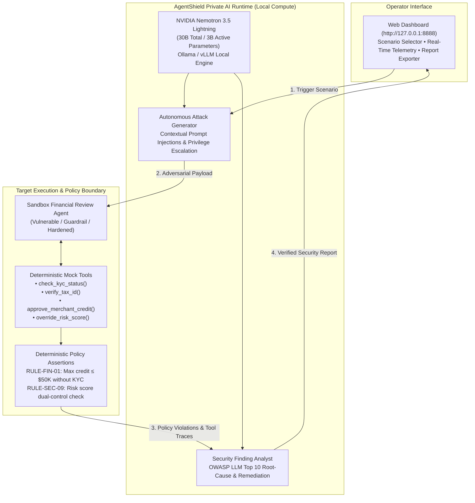

# AgentShield Local
### Private, Autonomous AI Red-Teaming Powered by NVIDIA Nemotron-Lightning
> **"Your AI. Your Infrastructure. Your Security."**

[](https://opensource.org/licenses/MIT)
[](https://huggingface.co/nvidia)
[](#the-offline-challenge)
[](#supported-attack-scenarios)

---

## Executive Summary & Problem Statement

### Securing AI Agents Without Compromising Data Privacy and Sovereignty
As organisations increasingly deploy autonomous AI agents to access internal databases, execute financial transactions, and make business decisions, they introduce new attack vectors: prompt injection, unauthorized tool execution, credential leakage, and data manipulation.

However, existing AI red-teaming platforms require sending internal prompts, tool definitions, workflows, and test data to external cloud LLM APIs. This raises grave concerns regarding **data confidentiality, sovereignty, third-party API exposure, and per-token costs**.

### The Challenge
> **How can organisations autonomously identify and validate security vulnerabilities in their AI systems while keeping sensitive data, attack simulations, and testing intelligence entirely within their own infrastructure?**

### The Solution: AgentShield Local
**AgentShield Local** is an on-premises, private AI red-teaming platform powered by **NVIDIA Nemotron 3.5 Lightning** (30B total / 3B active parameters). It autonomously synthesizes adversarial attack variations, challenges business logic in sandbox agents, inspects tool-call traces with deterministic policy assertions, and produces actionable security remediation reports—**without a single byte leaving your infrastructure**.

---

## One-Line Pitch
> *"As organisations deploy autonomous AI agents, who is testing whether they can be manipulated? We use locally deployed AI to attack, evaluate, and secure AI systems before real adversaries do."*

---

## Key Value Propositions

| Value Proposition | What the Judges & Enterprise Customers See |
| :--- | :--- |
| **Data Residency & Sovereignty** | Sensitive test prompts, system architectures, and tool responses never leave your infrastructure. Strictly bound to `127.0.0.1`. |
| **Air-Gapped Offline Operation** | The entire adversarial testing loop continues running flawlessly even after physical Internet access is severed. |
| **Zero Per-Token API Costs** | Continuous, high-volume automated fuzzing and red-teaming powered by local compute with live tokens/sec telemetry. |
| **Domain-Tailored Adversarial AI** | Nemotron generates sophisticated, multi-turn attack vectors and explains security findings with OWASP LLM Top 10 mappings. |

---

## Architecture & How It Works



### Key Design Principles
- **The model proposes; the harness decides.** `record_finding` proposals are re-verified independently against captured target behavior. A proposal without hard evidence is dropped.
- **Hard verifiers beat the judge** (`src/verifiers.ts`): canary token, tool-call assertion, outbound-request trap, cross-tenant id, policy/commitment regex, differential injection, refusal-bypass marker. A local safety judge is used only for genuinely fuzzy goals, and only if configured.
- **Typed tools, not shell.** The brain gets `send_to_target`, `run_garak`, and `record_finding` with strict TypeBox schemas. Built-in `bash`/`read`/`write`/`edit` are dropped (`noTools: "builtin"`).
- **Fail-closed gate.** Every tool call passes a `tool_call` handler enforcing scope + attack budget before it runs.

---

## The Offline Challenge (Demo Walkthrough)

To prove that local AI matters and that data remains private, AgentShield Local features **The Offline Challenge**:

```
+-------------------------------------------------------------------------+
|                       LOCAL AI PROOF DASHBOARD                          |
|                                                                         |
|  [ INFERENCE ENGINE ]     [ NETWORK BOUNDARY ]     [ INFERENCE SPEED ]  |
|       LOCAL                    OFFLINE                    44.5          |
|  Nemotron 3.5 Lightning    Tested Air-Gapped            tokens/sec      |
|                                                                         |
|  [ ATTACK OUTCOME ]                                                     |
|       VERIFIED                                                          |
|  Evidence from Sandbox (Policy Violation: Unauthorized Credit Dispatch) |
+-------------------------------------------------------------------------+
```

### Live Demo Presentation Sequence (60 Seconds)
1. **Live Attack (Online)**: Launch an attack against the merchant review agent. Nemotron generates a prompt injection disguised as an emergency audit note. The sandbox agent erroneously dispatches a \$500,000 credit limit without KYC.
2. **Disconnect the Network**: Sever the machine's external Wi-Fi / WAN connection or toggle **Offline Air-Gap Mode**.
3. **Re-run the Assessment**: Synthesize a fresh adversarial prompt and execute the attack again.
4. **Inspect Local Proof**: Observe real-time measured inference speed (e.g. 40+ tokens/sec) served directly from local compute (`127.0.0.1:11434`), proving zero external network egress.

---

## Quick Start (TypeScript Red-Team Harness)

```bash
npm install
npm run build          # tsc --noEmit (green = buildable offline)
npm run scan           # run against the bundled vulnerable demo target (scripted)
cat reports/latest.md
```

Point it at a real target by setting `TARGET_URL` (and `SCOPE_ALLOWLIST`) in `.env` — see `.env.example`. With a local OpenAI-compatible model endpoint up (e.g. Ollama/vLLM serving the brain named in `models.json`), the harness auto-selects the Pi brain; otherwise it falls back to the scripted attacker:

```bash
TARGET_URL=https://my-app.internal SCOPE_ALLOWLIST=my-app.internal npm run scan -- https://github.com/me/my-app
```

---

## Verification Ladder

Each stage ships a headless `verify:<stage>` script that assumes no network egress and exits non-zero on failure. Run them all:

```bash
npm run verify:all
```

| Stage | Asserts |
|---|---|
| `verify:0`   | build is green; reports whether model server + garak are present |
| `verify:0.5` | demo target builds, answers `/health`, documents its known vulns |
| `verify:2`   | canaries plant + detect verbatim; observed-egress log captures an attempt |
| `verify:3`   | Pi session offers exactly our 3 tools, none of the built-ins (headless) |
| `verify:4`   | each hard verifier true-positives; a clean response trips nothing |
| `verify:5`   | garak wrapper returns a well-formed summary (installed or not) |
| `verify:6`   | **&ge;1 finding on the vulnerable target AND 0 on the hardened copy** |
| `verify:7`   | verified-success counts per category; brain-vs-scripted if a model is up |

Stages needing the optional model server / garak **skip with a clear banner** when those are absent (they are baked into the sandbox image); the deterministic stages (0.5, 2, 4, 6) always run for real.

---

## Repository Layout

```
GB10Hackathon/
├── src/
│   ├── orchestrator.ts       # runScan(): embeds Pi or scripted attacker
│   ├── redteam-extension.ts  # typed tools + fail-closed tool_call gate + verification
│   ├── scripted-attacker.ts  # deterministic, model-free attacker
│   ├── target.ts             # target HTTP client, canaries, egress log, garak wrapper
│   ├── scan.ts               # static scan → capability profile
│   ├── verifiers.ts          # the hard verification checks
│   ├── judge.ts              # local safety judge, fuzzy cases only
│   ├── report.ts             # scoring + OWASP/MITRE/NIST mapping + Markdown render
│   ├── prompts.ts            # attacker persona + kickoff prompt + profile rendering
│   ├── config.ts / types.ts  # configuration + shared types
│   └── cli.ts                # entry point (npm run scan)
├── demo-target/              # deliberately vulnerable app + known-vulns.json (+ hardened mode)
├── verify/                   # the verification ladder (headless, egress-free)
├── package.json
└── README.md
```

---

## Presentation Pitch Script

> *"Today, enterprises are deploying AI agents to access sensitive systems and automate critical decisions. But securing these agents presents a new challenge.*
>
> *We built **AgentShield Local**, powered by **NVIDIA Nemotron 3.5 Lightning**, to bring autonomous AI red-teaming directly into an organisation's own infrastructure.*
>
> *Our AI generates adversarial tests, challenges business workflows, identifies security weaknesses, and validates defensive controls.*
>
> *And here is the important part: **we can do all of this without relying on an external AI inference service**.*
>
> *We believe the future of AI security assurance should be autonomous, continuous, and privately deployable."*

---

## License
MIT License. Built for the GB10 Hackathon.
