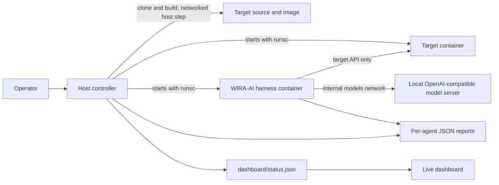

# WIRA-AI

WIRA-AI is a local-first security assessment project for AI agents. It combines a TypeScript red-team harness, an instrumented demo agent, an optional local model, and a Docker/gVisor workflow for assessing a containerized target repository.

The project has two related ways to run assessments:

- **Local harness:** exercise the TypeScript attack, verification, scoring, and reporting pipeline against the bundled demo target.
- **Isolated repository run:** clone and build a supported target, then run the harness and target in separate gVisor containers while a local dashboard reports progress.

The isolated workflow currently has a curated manifest for [Damn Vulnerable AI Agent (DVAA)](https://github.com/opena2a-org/damn-vulnerable-ai-agent). A repository needs a matching manifest and a root-level `Dockerfile` before the controller can run it.

## Architecture



The assessment is organized around a strict division of responsibilities:

1. The host controller clones the target and builds its image. This preparation step uses the host's network and is outside the gVisor runtime.
2. Docker Compose starts the target and harness under `runsc` with read-only container filesystems, dropped Linux capabilities, resource limits, and temporary writable mounts where needed.
3. The target is attached only to the internal target network. The harness can reach the target and the internal model network; the target cannot reach the model server or the internet.
4. The harness profiles target source, sends bounded adversarial inputs, records observed behavior, and independently verifies proposed findings.
5. The controller streams stage, isolation, and per-agent status to the dashboard, collects reports, and tears down the run containers and temporary run directory.

The network boundary applies to the running containers. Cloning a repository and building its image happen on the host before isolation, so only use repositories you trust and are authorized to assess.

## Assessment pipeline

The TypeScript harness in `src/` owns the assessment logic:

- `scan.ts` reads source files and heuristically builds a capability profile, such as tool use, RAG, authentication, multi-tenancy, or outbound fetching. It is a source-pattern scanner, not a compiler or a complete static analyzer.
- `target.ts` connects to the target, plants per-run canaries, sends test messages, and collects instrumented signals such as tool calls, canary exposure, cross-tenant identifiers, and attempted outbound requests.
- `orchestrator.ts` coordinates profiling, target interaction, attack execution, and report generation. In `auto` mode it uses the configured model if its endpoint is reachable, otherwise it selects the deterministic scripted attacker.
- `redteam-extension.ts` exposes typed attack tools to the model and applies scope and per-run budgets. The model may propose findings, but does not decide which findings are accepted.
- `verifiers.ts` checks concrete evidence, including leaked canaries, unexpected tool calls, egress attempts, cross-tenant data, forbidden commitments, differential behavior, and refusal-bypass markers. `judge.ts` is an optional fallback for fuzzy content judgments; it is disabled unless configured.
- `report.ts` computes the project’s resiliency score and maps verified findings to OWASP, MITRE ATLAS, and NIST AI RMF references. The score is an assessment aid, not a certification or proof that a target is safe.

The bundled demo target in `demo-target/` is deterministic; it does not call a model. It includes vulnerable and hardened modes so the harness can be exercised and false positives checked without external services.

## Quick start: local harness

Requirements: Node.js 20 or newer and npm.

```bash
npm ci
npm run build
npm run scan
```

With no arguments, `npm run scan` starts the bundled vulnerable demo target, profiles `demo-target/`, and runs in `auto` mode. If the configured model endpoint is unavailable, it falls back to the scripted attacker. Reports are written to `reports/latest.md`, `reports/latest.json`, and timestamped files in `reports/`.

To run the bundled demo in the hardened mode or force the scripted attacker, use the CLI directly:

```bash
npx tsx src/cli.ts demo-target --demo hardened --attacker scripted
```

The local harness expects the target interaction and instrumentation endpoints implemented by the demo (`/health`, `/chat`, `/__plant__`, and `/__signals__`). It does not automatically adapt an arbitrary public URL to that interface. Use the isolated workflow below for the supported DVAA repository.

### Optional model and judge configuration

The model brain uses a local OpenAI-compatible endpoint by default. Configure it with environment variables; no API key is needed for a local server that does not require one.

```bash
export MODEL_BASE_URL=http://localhost:8000/v1
export MODEL_API_KEY=local
export BRAIN_PROVIDER=local
export BRAIN_MODEL=your-served-model-id
```

Set `JUDGE_BASE_URL`, `JUDGE_MODEL`, and optionally `JUDGE_API_KEY` only if you want a separate judge for fuzzy content checks. Hard verifiers still take precedence. If a model server is unreachable, `auto` mode uses the scripted attacker.

`.env.example` lists the available settings, but the CLI does not load `.env` automatically. Export variables in your shell before starting it. The default model endpoint is `http://localhost:11434/v1`, with model ID `nemotron-3.5-lightning`. The reachability probe checks for an HTTP response, so an authentication error can still select model mode; model failures are recorded in report notes rather than retried with the scripted attacker.

## Isolated repository workflow

This workflow is designed for a Linux host with Docker Compose v2, Python 3, `runsc` (gVisor), and a local OpenAI-compatible model server such as vLLM attached to an internal Docker network. `sandbox/setup-host.sh` uses `sudo` and systemd when it needs to install or register gVisor, so review and run it on the intended host.

Initialize the harness submodule and prepare the host:

```bash
git submodule update --init --recursive
VLLM_CONTAINER=<your-model-container> sandbox/setup-host.sh
sandbox/smoke-test.sh
```

The setup script creates the internal `dgx_models` Docker network and attaches the named model container to it. The smoke test checks the gVisor runtime, target isolation, harness connectivity, and model-network wiring.

In one terminal, start the live dashboard:

```bash
dashboard/serve.sh 8800
```

Open <http://localhost:8800/>. In another terminal, start an assessment:

```bash
sandbox/controller.sh https://github.com/opena2a-org/damn-vulnerable-ai-agent 600
```

The controller requires a target URL with a corresponding JSON file under `sandbox/targets/`, and the repository must provide a root-level `Dockerfile`. It uses the `dvaa.json` manifest and, by default, assesses `securebot`, `legacybot`, `ragbot`, and `databot`.

Useful environment variables:

| Variable | Default | Purpose |
|---|---|---|
| `SANDBOX_RUNTIME` | `runsc` | Container runtime; the preflight expects gVisor. |
| `VLLM_URL` | `http://vllm:8000/v1` | Model API reachable from the harness on the internal models network. |
| `MODELS_NETWORK` | `dgx_models` | Existing internal Docker network for the model server. |
| `AGENTS` | `securebot legacybot ragbot databot` | Space-separated manifest agent IDs to assess. |
| `BUILD_TIMEOUT` | `900` seconds | Host-side target image build timeout. |
| `START_TIMEOUT` | `120` seconds | Target health-check startup timeout. |
| `KEEP_RUN_DIR` | `0` | Set to `1` to retain the temporary run directory for inspection. |

The controller writes per-agent and aggregate JSON reports under `reports/`. It removes the run containers and, unless `KEEP_RUN_DIR=1`, the cloned source and temporary run files on exit.

## Verification

Run the local verification ladder with:

```bash
npm run verify:all
```

The stages cover build/demo readiness, canary and egress instrumentation, the Pi tool surface, hard verifier behavior, the optional Garak wrapper, vulnerable-versus-hardened detection, and benchmark reporting. Checks that depend on an optional local model service or Garak report when those tools are unavailable; read each stage output for the actual result.

For sandbox wiring and isolation checks, run `sandbox/smoke-test.sh` on the configured Linux/Docker host.

## Repository map

```text
src/                    TypeScript CLI, orchestrator, attacker tools, verifiers, reports
demo-target/            Deterministic vulnerable/hardened fixture and known vulnerabilities
verify/                 Local build, pipeline, verifier, Garak, and benchmark checks
harness/                Docker image definition; red-team harness is a Git submodule
sandbox/                gVisor Compose config, host setup, controller, and target manifests
dashboard/              Live run dashboard, status writer, and static server
SANDBOX.md              Concise operational notes for the isolated workflow
```

## Scope and safe use

### Credentials and assessment artifacts

Supply real model and judge keys through environment variables. The harness writes the model key to `.pi-agent/models.json`; on POSIX systems its directory is restricted to the owner and the file uses mode `0600`, including existing files. `.pi-agent/` is ignored by Git. Environment variables and file permissions do not encrypt credentials.

Reports, captured responses, and `.pi-agent/workdir/transcript.json` can contain sensitive target data. Generated reports, local scan results, screenshots, `.env`, and `.env.*` files are ignored; `.env.example` remains tracked. Review artifacts before sharing them, and keep only dummy values in examples and fixtures. Ignore rules do not remove files already committed.

With [Gitleaks](https://github.com/gitleaks/gitleaks) installed, scan local files and all locally available branch history before publishing:

```bash
gitleaks dir . --redact
gitleaks git . --log-opts="--all" --redact
```

The deliberately vulnerable target checkouts and test fixtures contain fake secrets and may trigger findings. Review each finding rather than excluding entire credential rules. If a real credential was committed, revoke or rotate it first; removing it from the current files does not remove it from Git history.

### Authorized targets

Only assess systems you own or have explicit permission to test. The scripted and model-driven attacks are bounded by scope checks and per-run budgets in the TypeScript harness. In the isolated workflow, the target cannot make outbound network requests while running; the harness can contact the configured model service over the internal network. Avoid configuring a third-party model endpoint when prompts or target responses must remain local.

WIRA-AI provides evidence from the tests that actually ran. Heuristic source matches and model judgments require review, and an assessment that finds no issue does not establish that a target is secure.
